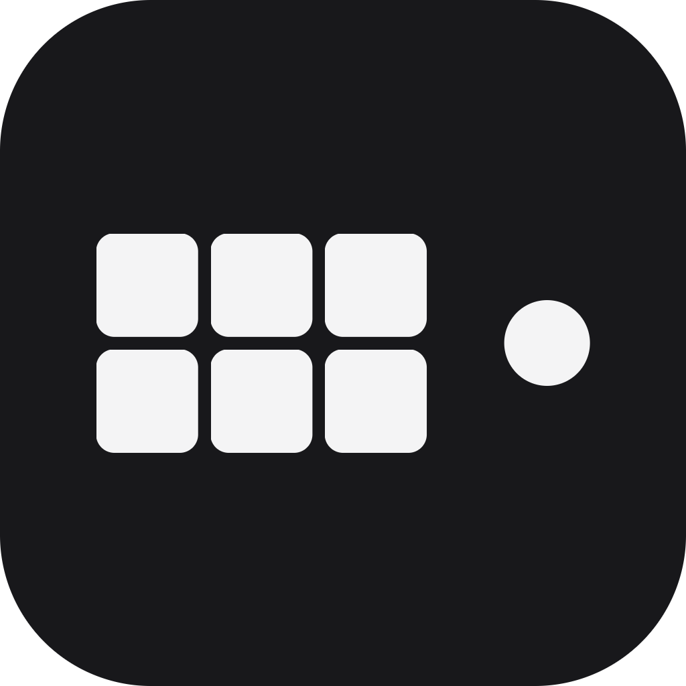

<p align="center">
  
</p>

<h1 align="center">Vibe Coder Deck</h1>

<p align="center">
  A Stream Deck–style control center for the <a href="https://github.com/nacif-software/vibe-coder-keyboard">vibe-coder-keyboard</a> macropad.<br>
  Assign scripts, shell commands and keystroke macros to its six keys and knob, switch profiles per app, and let an AI agent configure it over MCP.
</p>

<p align="center">
  
  
  
  
  
</p>

---

## Table of contents

- [What it is](#what-it-is)
- [Features](#features)
- [How it works](#how-it-works)
- [Quick start](#quick-start)
- [The app](#the-app)
- [Updates and patch notes](#updates-and-patch-notes)
- [Macros](#macros)
- [Profiles](#profiles)
- [Command line](#command-line)
- [MCP: let an AI set the pad up](#mcp-let-an-ai-set-the-pad-up)
- [Where the data lives](#where-the-data-lives)
- [Project layout](#project-layout)
- [Development](#development)
- [Troubleshooting](#troubleshooting)
- [Status and roadmap](#status-and-roadmap)

## What it is

The [vibe-coder-keyboard](https://github.com/nacif-software/vibe-coder-keyboard) is a cheap
6-key + 1-knob USB macropad (VID `0x1189`, PID `0x8890`) and a CLI, `macropad`, that writes key
combos into its flash memory. The pad can only ever *send keystrokes*: no delays, no long text,
no launching apps, no scripts.

**Vibe Coder Deck** is the desktop companion that closes that gap. It is one Go binary that:

- shows a page laid out like Logitech G HUB, with the pad drawn as it looks, where you say what each
  of the nine controls does;
- registers nine global hotkeys and, when the pad presses one, runs a script, a shell command or a
  macro on this computer;
- keeps a **macro library** with a recorder, a block editor and four macro types;
- keeps **profiles** per application and switches them as you change the app in front;
- guards every key with cooldowns and a single-instance lock, and logs every press;
- speaks the **Model Context Protocol**, so an agent such as Claude Code can configure the keys,
  write the pad and even render it inside the chat (MCP Apps).

Go, SQLite, no services, no accounts. macOS today, Windows and Linux in preview.

```
┌───────────┬───────────┬───────────┐
│  key1     │  key2     │  key3     │      knob: left · press · right
├───────────┼───────────┼───────────┤
│  key4     │  key5     │  key6     │
└───────────┴───────────┴───────────┘
```

## Features

| | |
|---|---|
| **Five slot modes** | `off`, `keys` (the pad types it), `script`, `shell`, `macro` |
| **Macro library** | once / repeat while held / toggle / sequence (press, hold, release steps) |
| **Recorder** | captures key down, key up, the milliseconds between them and mouse clicks |
| **Block editor** | drag and drop steps, fold key down/up pairs, standard delays, text, launch app, media keys |
| **Profiles** | Desktop plus one or more profiles per app; automatic switching by the app in front |
| **Guardrails** | per-slot cooldown, single-instance lock, run log with `ok` / `failed` / `skipped` |
| **Live pad** | writes the pad over USB itself (no CLI, no driver), lights the key you press on the real pad, applies changes on save |
| **Key icons** | built-in drawings, emoji, short text or your own image on every keycap |
| **Native app** | window (Wails / WKWebView), menu bar icon, Dock presence, start at login, light and dark |
| **MCP** | 11 tools over HTTP and stdio, one-click install into Claude Code, Claude Desktop, Cursor, Windsurf, Codex |
| **MCP App** | the pad rendered inside the chat, editable by the user, reported back to the agent |
| **Releases** | GitHub Releases for macOS (universal) and Windows, patch notes in the app, automatic updates verified with SHA-256 |

## How it works

Each of the nine slots (key1..key6, knob-left, knob-press, knob-right) has a mode. The mode
decides who does the work and what gets written into the pad's flash memory:

| Mode | Who does the work | What the pad holds |
|---|---|---|
| `off` | nobody | cleared |
| `keys` | the pad itself: a macropad action such as `cmd+shift+4`, `cmd+a, cmd+c`, `volume-up` | the action |
| `script` | this program runs a script file | `ctrl+opt+cmd+<digit>` |
| `shell` | this program runs a command line | `ctrl+opt+cmd+<digit>` |
| `macro` | this program plays a macro from the library | `ctrl+opt+cmd+<digit>` |

The digit is the slot position: key1..key6 are 1..6, knob left / press / right are 7 / 8 / 9.
The app registers those nine hotkeys globally; when the pad "types" one, the dispatcher looks up
the slot in the active profile and runs it.

System shortcuts such as screenshots and Spotlight ignore synthetic keystrokes, so they belong in
`keys` mode, where the pad is a real keyboard. Everything that needs timing, text, app launches or
logic belongs in `script`, `shell` or `macro` mode.

Every dispatched slot can get a **cooldown** (seconds to ignore further presses) and be
**single instance** (ignore presses while a run is in flight). Each press becomes a row in the run
log (`running`, `ok`, `failed`, `skipped`), shown on the page as a colored dot on the key.

Saving a key on the page writes the pad right away. If the pad is unplugged, the key stays saved
and a banner offers **Apply to pad** to retry.

## Quick start

### Requirements

- macOS 12 or newer (Windows and Linux: see [Status](#status-and-roadmap); Linux has its own
  [section](#linux-preview))
- [Go 1.26](https://go.dev/dl/)
- Nothing else: the app writes the pad over USB by itself (IOKit on macOS, no driver and no
  permission; hidraw on Linux, with a udev rule). The `macropad` CLI of vibe-coder-keyboard is not
  needed; `VCK_MACROPAD=macropad` makes the app use it instead.

### Download a release

Every version is on the [Releases](https://github.com/nacif-software/vibe-coder-deck/releases) page:

| File | What to do |
|---|---|
| `Vibe-Coder-Deck-vX.Y.Z-macos.zip` | unzip, drag **Vibe Coder Deck.app** to Applications, open it. The app is not notarized yet: the first time, right-click it and choose **Open** (or allow it under System Settings → Privacy & Security). |
| `vibe-coder-deck-vX.Y.Z-windows-amd64.zip` | unzip `vibe-coder-deck.exe` anywhere and run it (it lives in the tray). |
| `vibe-coder-deck-vX.Y.Z-linux-amd64.zip` | unzip and follow its `README.md`: the binary goes to `~/.local/bin`, `vibe-coder-deck udev --install` grants device access, the `.desktop` entry puts it in your app menu. See [Linux](#linux-preview). |
| `checksums.txt` | SHA-256 of every file, what the app checks before it updates itself. |

### Or build and install it yourself

```sh
git clone https://github.com/nacif-software/vibe-coder-deck
cd vibe-coder-deck
scripts/build-app.sh --install      # builds and installs "/Applications/Vibe Coder Deck.app"
```

Open the app. Its window shows the pad; the menu bar gets an icon. On first launch macOS asks for
two permissions (see below). Pick a key, choose what it does, save: the pad is written immediately.

### Permissions (macOS)

The app asks for both with macOS's own prompt, and the page shows what is still missing with an
**Allow** button that opens the right System Settings pane.

| Permission | Needed for |
|---|---|
| **Accessibility** | the global hotkeys and macro playback |
| **Input Monitoring** | the macro recorder and seeing which pad key was pressed |

`scripts/build-app.sh` signs the bundle with a local self-signed certificate named
**"Vibe Coder Deck Local Signing"** when your login keychain has one, so the grants survive
rebuilds. Without it the app is signed ad hoc and must be granted again after every build.

### Or run it from a terminal

```sh
go build -o vibe-coder-deck .
./vibe-coder-deck serve --open      # page + hotkeys, no menu bar icon
```

The page is served at `http://127.0.0.1:7071` either way.

### Linux (preview)

Everything the pad does works the same on X11 and Wayland, because nothing goes through the
display server: the app reads the pad's own input device (evdev), grabs it, dispatches
`ctrl+opt+cmd+1..9` itself and types everything else the pad sends again through a virtual
keyboard (uinput); macros, media keys and clicks are typed through that same virtual keyboard.
"Which app is in front" (profile switching) works on X11; under Wayland the Desktop profile stays
(per-compositor support is planned).

```sh
unzip vibe-coder-deck-*-linux-amd64.zip -d vibe-coder-deck && cd vibe-coder-deck
install -Dm755 vibe-coder-deck ~/.local/bin/vibe-coder-deck
mkdir -p ~/.local/share/applications
sed "s|^Exec=.*|Exec=$HOME/.local/bin/vibe-coder-deck app|" vibe-coder-deck.desktop > ~/.local/share/applications/vibe-coder-deck.desktop
install -Dm644 vibe-coder-deck.png ~/.local/share/icons/hicolor/256x256/apps/vibe-coder-deck.png
vibe-coder-deck udev --install      # asks for your password; then unplug and replug the pad
```

`udev --install` writes `/etc/udev/rules.d/70-vibe-coder-deck.rules` (print it with
`vibe-coder-deck udev`), which gives the logged-in user the pad's input and hidraw nodes and
`/dev/uinput` without root. The page's **Permissions** section shows what is still missing and
its **Allow** buttons install the rule:

| Permission | Needed for |
|---|---|
| **Virtual keyboard** (`/dev/uinput`) | typing macros and forwarding the pad's keys |
| **Read the pad's keys** | the hotkeys: the pad's own input device |
| **Write the pad** | **Apply to pad** (hidraw) |
| **Record keystrokes** | the macro recorder reads every keyboard: `sudo usermod -aG input $USER`, then log out and in |

Needs GTK 4.10+ and WebKitGTK 6.0 at run time (`libgtk-4-1`, `libwebkitgtk-6.0-4` on
Debian/Ubuntu) and a StatusNotifier host for the tray icon (KDE has one; GNOME needs the
AppIndicator extension). `text` steps type as on a US keyboard; combos by key name work on any
layout. Updates replace the binary in place. The pad itself has not been tried on a Linux machine
yet (everything above is verified in a container with a virtual pad): reports welcome.

## The app

The window is a native webview ([Wails v3](https://wails.io): WKWebView on macOS, WebView2 on
Windows). The layout follows Logitech G HUB:

- **Assignments** on the left, for the selected control, with tabs **Macros**, **Keys**,
  **Commands**, **System** and **When it runs** (cooldown, single instance). A **Keys** combo of only
  modifiers (`ropt`, `ctrl+shift`) is held for as long as the key is held.
- **The pad** in the middle, drawn as it looks (six keycaps, the knob, the NACIF VibeCoder plate),
  with a status dot on every key and knob part and a line to what it does. A key pressed on the
  real pad lights up in the drawing and opens for editing.
- **Devices | Profiles** tabs and a profile picker at the top.

Each key can carry an icon on its cap, like the real keycaps (key 1 starts with the skull printed on
the pad): a built-in drawing, an emoji or short text, or any picture you upload (PNG, JPEG, GIF,
WebP shrunk to 128 px, or SVG, up to 256 KB).

The **menu bar icon** (tray on Windows) offers **Open Vibe Coder Deck**, **Apply to pad**, the hotkey
status, **Start at login**, **Restart** and **Quit**. While the window is open the app is also in the
Dock, with a menu bar, cmd+Q and a place in Force Quit, so it stays reachable when the menu bar icon
is hidden behind the notch. Closing the window hides it; the keys keep working until **Quit**. A
login start keeps the window hidden.

The gear (top right) opens **Settings**, a view of its own laid out like G HUB's, with a list on the
left:

- **General**: **Launch app on login** (desktop app only), **Appearance** (system, light or dark),
  the macOS **Permissions** and whether each is on, and **Restart app**.
- **Updates**: the current version, **Check for update**, **Enable Automatic Updates** and the
  release notes of every version.
- **Logs**: **Debug mode** (also logs polled requests, recorder events, raw pad keystrokes and
  hotkeys; remembered across restarts) and the tail of `deck.log`, live, with copy and open buttons.
- **AI setup**: the MCP install buttons.
- **About**: the version, its notes and the source repository.

The gear again goes back to the pad. The ☀︎/☾ button in the header switches light and dark too.

## Updates and patch notes

The app keeps itself current. Twenty seconds after it starts, and every six hours, it asks GitHub
for the newest release. With automatic updates on (the default) a newer release is
downloaded in the background and verified against the release's `checksums.txt` (**Enable Automatic
Updates** in Settings › Updates); the page then shows
a banner and the menu bar item reads **Restart to update**. Nothing is installed until you click:
the app on disk is swapped for the new one and the app restarts. Development builds (made from a
commit, not a tag) are never updated automatically.

**Settings › Updates** lists every release with its notes, straight from GitHub, or from the
changelog built into the app when GitHub cannot be reached. The first start of a new version opens
a **What's New in Version …** card with that version's notes (**See release notes** opens the
release page, **Got it** closes it); the update banner and About open it too.

```sh
vibe-coder-deck update              # current and latest version, with the notes
vibe-coder-deck update --install    # download, verify and install the newest release
```

Releases of a private repository need a token: `VCD_GITHUB_TOKEN` in the environment, or
`vibe-coder-deck update --token TOKEN` to keep one (`--clear-token` forgets it). A public
repository needs none.

Without a signing certificate in the release workflow (see [Releasing](#releasing)) the app is
signed ad hoc, and macOS asks for Accessibility and Input Monitoring again after an update.

## Macros

Macros live in a **library**: create one (name, type, editor), then pick it from the Macros tab to
assign it to a key. The same macro can sit on several keys and profiles.

| Type | Behaviour |
|---|---|
| **Once** | plays the steps on each press |
| **Repeat** | loops the steps while the key is held |
| **Toggle** | a press starts the loop, the next press stops it |
| **Sequence** | steps on press, other steps looped while held, other steps on release |

Steps are shown as blocks: ▼ key down, ▲ key up, the milliseconds between them, and chips for text,
shortcuts, app launches, media keys and clicks. Blocks can be dragged to reorder them, moved between
the press / hold / release lanes, folded (a key down and its key up move together); each macro gets a color.
A **standard delay** replaces every recorded wait with a fixed one.

| Step | Value |
|---|---|
| `keys` | a combo or sequence in pad syntax: `cmd+shift+4`, `cmd+a, cmd+c` |
| `text` | a string, emoji included |
| `delay` | milliseconds |
| `launch` | an app name or bundle path |
| `keydown` / `keyup` | a key name (`cmd`, `shift`, `a`, `enter`, `f8`, `play`, `volume-up`, …) or `code:N` |
| `click` | `left`, `right` or `middle`, at the pointer |

The **Record** tab captures what you do inside its box: every key down and key up as its own event
with the time between them, plus mouse clicks. Any event can be removed afterwards. On macOS the
recorded steps are posted as Quartz events, so a held modifier works exactly like on a real keyboard.

## Profiles

Profiles work like G HUB's. The **Desktop** and every app you add (from the installed apps list or
the system's own picker) have one or more profiles, each with its own nine controls. The selector at
the top picks the profile you edit; ● marks the one in use.

With **profile switching** on, the app in front picks its profile (the Desktop's otherwise). The
pad then holds only the nine hotkeys: `keys`-mode controls are typed by the app as keyboard events,
so switching never rewrites the pad. With switching off, the persistent profile is used and written
to the pad as is.

An app added by name gets its bundle id and path (and so its icon) filled in the first time it is
seen in front. Databases from before profiles are migrated: a key that was limited to one app
becomes a profile of that app.

## Command line

The app and the CLI are the same binary. Running it with no command opens the app.

```
vibe-coder-deck [command] [flags]

  (no command) / app [--addr 127.0.0.1:7071] [--db PATH]
                         the app: native window with the page, menu bar icon, hotkeys
  serve [--addr 127.0.0.1:7071] [--db PATH] [--open]
                         the same without the icon, in the terminal
  sync [--dry-run]       write the configuration into the pad (over USB)
  keys [--json]          list the nine slots
  set <slot> [--mode M] [--label L] [--action A] [--steps JSON] [--app APP]
              [--cooldown N] [--single-instance 0|1]
                         configure one slot (key1..key6, knob-left, knob-press, knob-right)
  import [FILE]          load nehacloud's "php artisan macropad:keys --json" (stdin by default)
  press <slot>           run a slot as if its key were pressed (through the server when it runs)
  mcp [--db PATH]        MCP server on stdio, for an AI agent to configure the pad
  mcp install [--client all|claude-code|claude-desktop|cursor|windsurf|codex] [--transport stdio|http]
                         register the MCP server with those AI tools
  update [--install] [--token T] [--clear-token]
                         look for a newer release and show its notes; --install downloads,
                         verifies and installs it; --token keeps a token for a private repository
  version
```

Examples:

```sh
vibe-coder-deck set key2 --mode keys --action "cmd+shift+4" --label "Shot"
vibe-coder-deck set key3 --mode shell --action "open -a Spotify" --cooldown 2
vibe-coder-deck set key4 --mode macro --steps '[{"type":"text","value":"hello@example.com"}]'
vibe-coder-deck sync --dry-run       # show what would be written to the pad
vibe-coder-deck press key3           # run a slot by hand
```

Only one hotkey listener can own `ctrl+opt+cmd+1..9`: run either the app or `serve`, not both,
and stop other tools that bind them (for skhd: `skhd --stop-service`).

## MCP: let an AI set the pad up

The app serves the [Model Context Protocol](https://modelcontextprotocol.io) over HTTP
(`http://127.0.0.1:7071/mcp`, while the app or `serve` runs) and over stdio
(`vibe-coder-deck mcp`, no app needed). The server's instructions explain the pad, the modes and
the action syntax, so an agent can go from *"set key3 to open Spotify, key4 to type my email, and
apply it to the pad"* to a written pad on its own.

| Tool | What it does |
|---|---|
| `list_profiles` | the Desktop and the apps with their profiles, the active and the persistent one |
| `list_keys` | the nine slots of a profile |
| `get_key` / `set_key` | read or configure one slot (mode, action, label, icon, cooldown, single instance) |
| `list_macros` / `set_macro` / `delete_macro` | the macro library |
| `sync_pad` | write the configuration into the pad |
| `press_key` | run a slot now |
| `list_runs` | what happened on the last presses |
| `show_pad` | the pad as an interactive view, or as text for hosts without MCP Apps |

It speaks the stateless 2026-07-28 revision of the protocol (`server/discover`, no session) and
still negotiates down for clients on older revisions.

### MCP App

`show_pad` is also an **MCP App** (extension `io.modelcontextprotocol/ui`, SEP-1865). Hosts that
support it render the `ui://vibe-coder-deck/pad` resource in the chat: the pad drawn as it looks,
with a profile picker. Picking a key opens an editor whose **Save** calls `set_key` and `sync_pad`
through the host, **Run** calls `press_key`, and every change is reported to the agent with
`ui/update-model-context`. The view is self-contained (no network, no external assets), so it runs
under the host's default CSP.

### Install into your AI tools

Through the app: **Settings › AI setup** has one button per tool. Or from
a shell:

```sh
vibe-coder-deck mcp install --client all          # Claude Code, Claude Desktop, Cursor, Windsurf, Codex CLI
vibe-coder-deck mcp install --client cursor --transport http
```

Config files are merged, never overwritten. By hand:

```sh
# HTTP, while the app (or `serve`) runs:
claude mcp add --transport http vibe-coder-deck http://127.0.0.1:7071/mcp
# stdio, no app needed (presses go through the app when it runs, locally otherwise):
claude mcp add vibe-coder-deck -- "/Applications/Vibe Coder Deck.app/Contents/MacOS/vibe-coder-deck" mcp
```

## Where the data lives

| | macOS | Windows |
|---|---|---|
| Directory | `~/Library/Application Support/vibe-coder-deck` | `%AppData%\vibe-coder-deck` |
| Database | `deck.db` (SQLite: apps, profiles, keys, macros, runs, cooldowns) | same |
| Log | `deck.log` | same |

`--db PATH` points any command at another database.

## Project layout

```
main.go                  CLI entry point: app, serve, sync, keys, set, import, press, mcp
internal/app/            the native app: Wails window, menu bar icon, Dock, tray icons
internal/deck/           the domain: slots, modes, keys, macros, profiles, SQLite store,
                         dispatcher, cooldown / single-instance gate, pad sync, key icons
internal/mcpserver/      MCP tools, the MCP App view (ui/pad.html), client installers
internal/update/         releases: versions, the GitHub API, the changelog, download, verify, install
internal/pad/            the pad's USB protocol: action syntax, packets, transports (IOKit,
                         hidraw, Windows HID), key tables; the macropad CLI as an opt-in fallback
internal/platform/       OS specifics: global hotkeys, keystroke playback, the recorder,
                         permissions, start at login, Dock, frontmost app, pad watcher
internal/web/            HTTP + JSON API and the page (static/index.html, app.js, style.css)
internal/debuglog/       the log file and debug mode
scripts/build-app.sh     macOS bundle, .icns, signing, --install (VCD_ARCHES="arm64 amd64" for universal)
scripts/build-windows.sh Windows tray build (dist/vibe-coder-deck.exe)
scripts/release.sh       tags a version and pushes the tag; GitHub Actions does the rest
scripts/gen-icons.py     draws the app and tray icons (standard library only)
.github/workflows/       release.yml (tag → build → GitHub Release), test.yml (pull requests)
CHANGELOG.md             the patch notes, one section per version (Keep a Changelog)
assets/                  the app icon
docs/                    design notes and plans
```

## Development

```sh
go vet ./...
go test ./...                               # 100+ tests, nothing touches the pad, hotkeys or screen
CGO_ENABLED=0 GOOS=windows go build .       # checks the Windows build
scripts/docker-linux.sh test                # the Linux port: every test in a container (uinput pad, Xvfb)
scripts/docker-linux.sh build               # the Linux zip into dist/ (no Linux machine needed)
scripts/build-app.sh --install              # rebuild and reinstall the macOS app
curl -X POST http://127.0.0.1:7071/api/app/restart   # restart the running app
```

The tests cover the slot and mode rules, the SQLite store and migrations, the gate, the dispatcher
(with a fake runner), the macro model, profiles, the pad protocol (packets checked byte for byte
against the `macropad` tool's dry run in `internal/pad/testdata`), the keystroke builders and the
JSON API. The MCP tools are tested end to end over the SDK's in-memory transport, including
the MCP App resource.

The page is plain HTML, CSS and JavaScript embedded in the binary: no build step, no framework.
It never uses the browser's `alert`, `confirm` or `prompt` (the native webview has none); dialogs
are the page's own.

### Releasing

1. Write the version's notes in `CHANGELOG.md` under `## [X.Y.Z] - YYYY-MM-DD` and commit.
2. `scripts/release.sh X.Y.Z` tags `vX.Y.Z` and pushes the tag.
3. GitHub Actions (`release.yml`) runs the tests on Ubuntu and macOS, builds the Linux zip (Ubuntu),
   the universal macOS app and the Windows exe (macOS), writes `checksums.txt` and publishes the
   Release with that section as its notes. Installed apps see it within six hours, or at once with **Check for updates**.

To sign the macOS app in the workflow, add two repository secrets: `MACOS_CERT_P12` (the
certificate and key as a base64 `.p12`: `base64 -i cert.p12 | pbcopy`) and `MACOS_CERT_PASSWORD`.
A self-signed certificate is enough for macOS to keep the permission grants across updates; a
Developer ID certificate also satisfies Gatekeeper on other Macs.

## Troubleshooting

| Symptom | Cause and fix |
|---|---|
| Keys do nothing | **Accessibility** not granted, or another listener (skhd, a second instance) owns `ctrl+opt+cmd+1..9`. Check the hotkey status in the menu bar menu. |
| Recorder refuses to start | **Input Monitoring** not granted. Without it macOS shows clicks but no keys. |
| Permissions asked again after a rebuild | Create the "Vibe Coder Deck Local Signing" certificate in Keychain Access so the signature is stable. |
| "Pad not connected" | Plug the pad (USB `1189:8890`). Saved keys are applied on the next **Apply to pad**. On Linux run `vibe-coder-deck udev --install` and replug the pad: its input and hidraw nodes need the rule. |
| Keys do nothing (Linux) | `/dev/uinput` or the pad's input device is not readable: the **Permissions** section says which; `vibe-coder-deck udev --install`, replug, restart the app. Under Wayland profile switching stays on the Desktop profile. |
| A screenshot or Spotlight shortcut does not fire | Put it in **Keys** mode: system shortcuts ignore synthetic keystrokes. |
| A key fires twice or overlaps | Set a cooldown or turn on single instance in **When it runs**. |

## Status and roadmap

- **macOS:** complete and in daily use.
- **Windows:** the tray app, the page, scripts, shell commands and macros (via PowerShell `SendKeys`)
  build and run; the pad is written through its HID interface (not yet tried on a real machine);
  recorded key down / key up steps are not played back yet, and the pad watcher and recorder are stubs.
- **Linux (preview):** the app (GTK4 + WebKitGTK), the page, scripts, shell commands, macros, the
  recorder and the pad writer run; the pad's keys are read from its own device, so X11 and Wayland
  are alike, and profile switching follows the app in front on X11. Verified in a container with a
  virtual pad and in CI; not yet on a Linux machine with the real pad.
- **Updates:** released through GitHub Actions; the app updates itself on both systems (the
  Windows path is built and unit-tested, not yet exercised on a real machine).
- **Planned:** Developer ID signing and notarization, Windows parity, Wayland "app in front"
  (GNOME, KDE, wlroots), Linux arm64 builds, more MCP App hosts.

## Related

- [vibe-coder-keyboard](https://github.com/nacif-software/vibe-coder-keyboard): the macropad this app
  configures, its USB protocol, and the optional `macropad` CLI.
